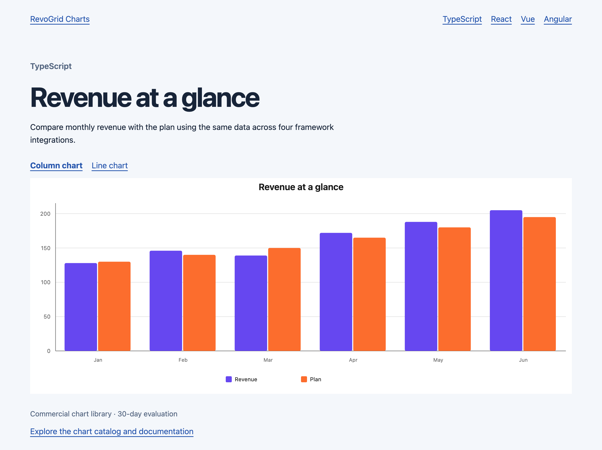

# RevoGrid Charts

Interactive JavaScript charts for reports and dashboards, with TypeScript,
React, Vue, and Angular integration examples.

[Chart catalog and live examples](https://pro.rv-grid.com/guides/charts/) ·
[Public trial](https://rv-grid.com/trial) ·
[Pricing](https://rv-grid.com/pricing/) ·
[Report an issue](https://github.com/revolist/charts/issues)



## What you can build

- Reports with line, column, area, pie, statistical, financial, hierarchy, and flow charts.
- Interactive dashboards with zoom, selection, annotations, and linked charts.
- Exportable visuals with SVG, image, and data download options.
- Standalone charts that use your application's data and work independently of a grid.

The commercial engine includes 68 built-in chart types. Check the
[chart type guides](https://pro.rv-grid.com/guides/charts/#available-chart-types)
for each type's supported options.

## Run the examples

Use Node.js 24 LTS (24.15 or later) and pnpm 10.

```sh
git clone https://github.com/revolist/charts.git
cd charts
pnpm install --frozen-lockfile
pnpm dev
```

Open the local URL printed by Vite, then choose a framework.

| Example | Local path | Integration source |
| --- | --- | --- |
| TypeScript | `/index.html` | [src/typescript.ts](src/typescript.ts) |
| React | `/react.html` | [src/react.tsx](src/react.tsx) |
| Vue | `/vue.html` | [src/vue.ts](src/vue.ts) |
| Angular | `/angular.html` | [src/angular.ts](src/angular.ts) |

Each example shows monthly revenue and plan values. Switch between a column
chart and a line chart using the links above the chart. Add `?lang=pt` to any
example URL for Portuguese labels.

The examples mount the chart engine through each framework's lifecycle.
[src/showcase.ts](src/showcase.ts) owns the chart configuration, sample data,
labels, and cleanup. The Angular example uses the compiler for a small,
directly runnable integration.

## Public trial installation

The project-local [.npmrc](.npmrc) routes the `@revolist` scope to the public
trial registry. The pinned `@revolist/charts-trial` package installs without a
login, token, or license key.

To evaluate the engine in another project, add this line to that project's
`.npmrc`:

```ini
@revolist:registry=https://trial.rv-grid.com
```

Then install the package:

```sh
pnpm add @revolist/charts-trial
```

See the [trial guide](https://rv-grid.com/trial) for evaluation terms and the
[Charts installation guide](https://pro.rv-grid.com/guides/charts/installation/)
for licensed production package access. The trial is for 30-day evaluation.
Production use requires a commercial license.

## Create a chart

Give the container an explicit height.

```html
<div id="chart" style="height: 400px"></div>
```

```ts
import { createChart } from '@revolist/charts-trial';

const chart = await createChart({
  container: document.getElementById('chart')!,
  chartType: 'line',
  data: [
    { month: 'Jan', revenue: 120 },
    { month: 'Feb', revenue: 180 },
  ],
  mapping: {
    category: { field: 'month' },
    series: [{ field: 'revenue', label: 'Revenue' }],
  },
  presentation: { title: 'Monthly revenue' },
});

// Release the chart when leaving the page.
window.addEventListener('pagehide', () => chart.destroy(), { once: true });
```

## Build and check

```sh
pnpm build
pnpm preview
```

The build typechecks the source and produces all four example pages.

## Documentation

- [Chart configuration and data](https://pro.rv-grid.com/guides/charts/data-and-configuration/)
- [Charts guide and catalog](https://pro.rv-grid.com/guides/charts/)
- [Installation](https://pro.rv-grid.com/guides/charts/installation/)
- [RevoGrid](https://github.com/revolist/revogrid)
- [Revo UI](https://github.com/revolist/revo-ui)

## Contributing

Issues and improvements to these integration examples are welcome. Include the
framework, browser, installed package version, and a small reproduction when
reporting a problem. Run `pnpm build` before submitting a change.

## License

The integration examples, sample data, and documentation in this repository
are MIT licensed. RevoGrid Charts is a commercial library, distributed
separately under its own license. Its evaluation and production terms apply
to the installed chart engine.
